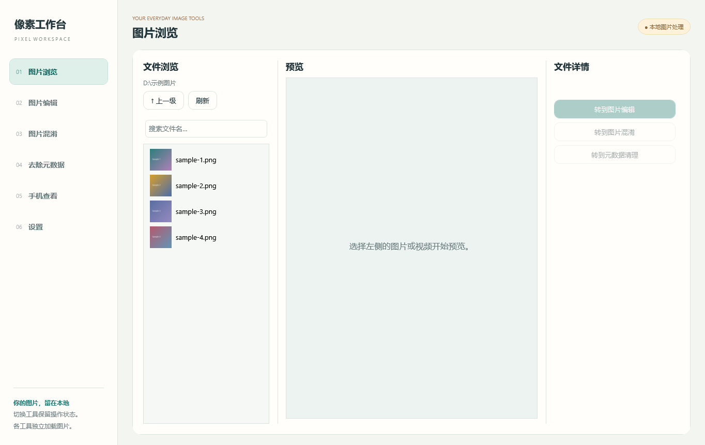
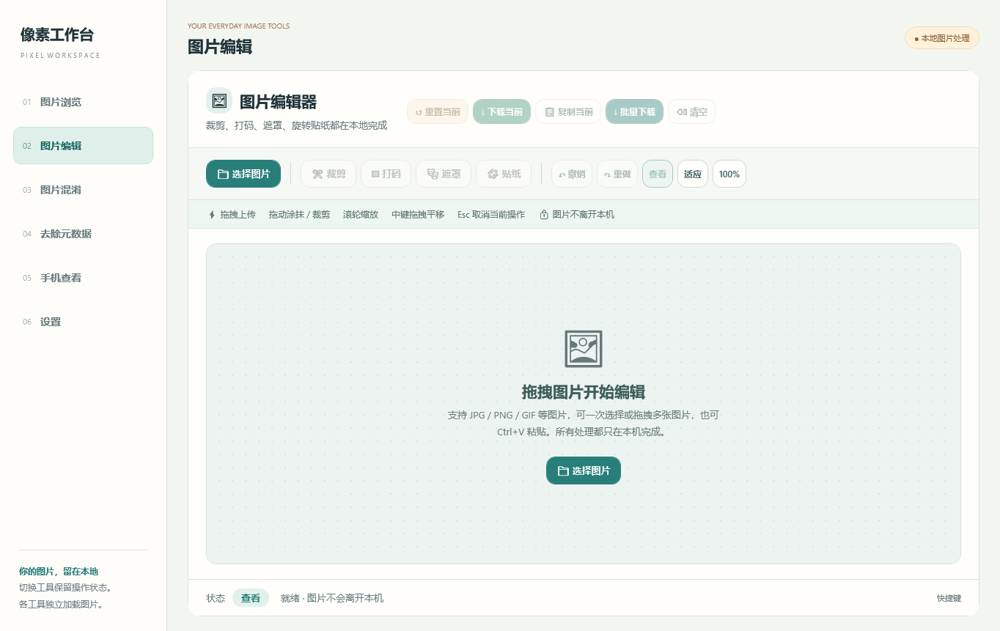
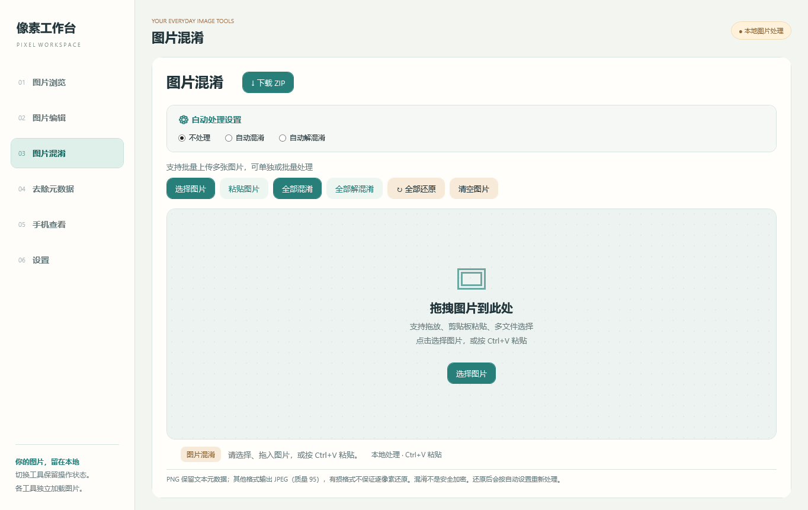
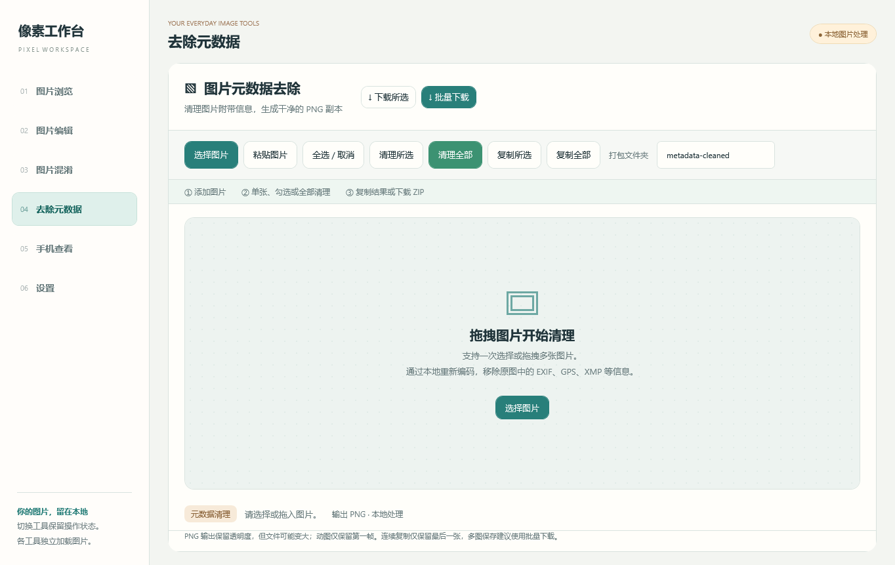
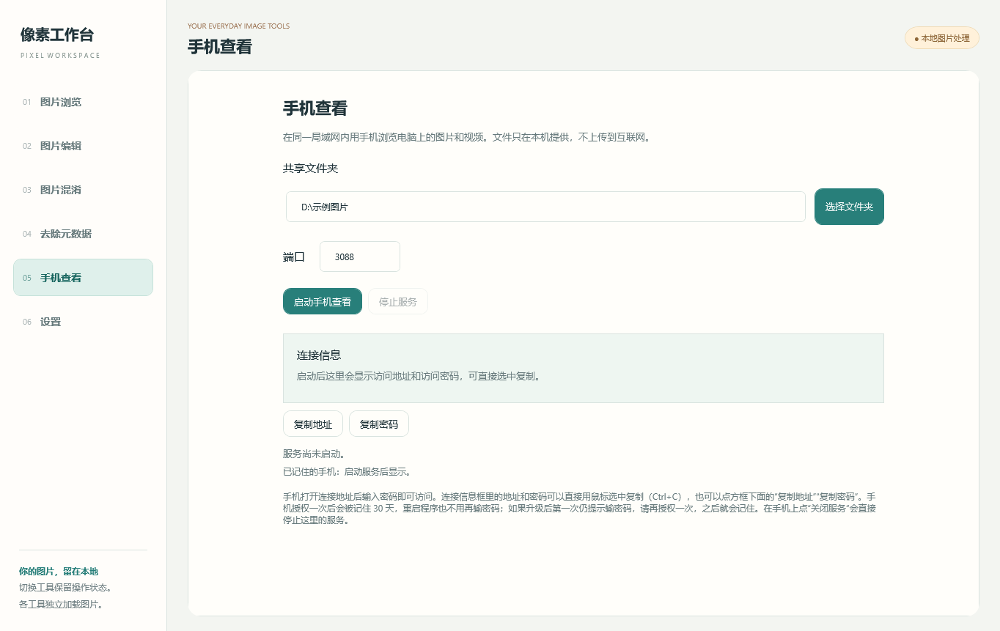
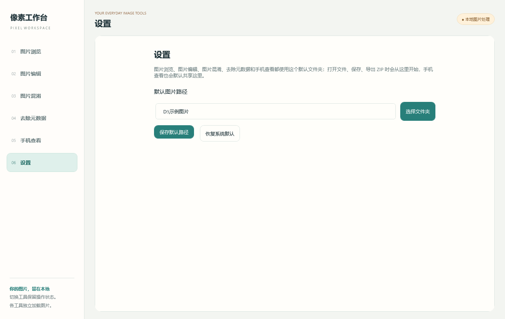

# 像素工作台 · Pixel Workspace

> Windows 上的本地图像工具箱：看图、修图、混淆、去元数据、用手机浏览，六个页面一个窗口，全部在本机完成。


原生 C# / .NET 10 / WPF 实现，不是 Electron、不是 WebView、不内嵌浏览器，也没有任何联网 API。图片、视频、元数据清理与局域网共享都在本机内存和本地文件里完成。

## 功能

| 序号 | 页面 | 能做什么 |
| --- | --- | --- |
| 01 | **图片浏览** | 左侧文件树浏览任意文件夹，双击进入目录；图片和视频直接预览，视频带播放/暂停、可拖动进度条、时间显示；5 秒自动刷新，新生成的图片自动出现；文件名搜索；右侧显示名称、尺寸、大小、是否含元数据，并可一键转到编辑 / 混淆 / 去元数据 |
| 02 | **图片编辑** | 多图导入、侧栏缩略图切换；裁剪、马赛克打码、高斯模糊遮罩、旋转贴纸；撤销 / 重做 / 重置；缩放、拖拽平移；每张图独立历史 |
| 03 | **图片混淆** | 可逆像素排列（Gilbert 曲线 + 四通道置换），支持批量选择、整批处理、整批还原、自动处理模式、导出 ZIP |
| 04 | **去除元数据** | 单张 / 勾选 / 全部重新编码为干净 PNG，清除 EXIF、GPS、XMP、PNG 文本块；批量下载 ZIP 并自定义内层文件夹名 |
| 05 | **手机查看** | 一键启动局域网文件服务，手机浏览器扫码无效也行——输入地址 + 一次性密码即可浏览电脑上的图片和视频；授权一次后 30 天内免密；手机上点"关闭服务"可直接停掉电脑端的服务 |
| 06 | **设置** | 统一的默认图片路径，六个工具共享；选择文件夹、保存、恢复系统默认 |

## 截图

| 图片浏览 | 图片编辑 |
| --- | --- |
|  |  |

| 图片混淆 | 去除元数据 |
| --- | --- |
|  |  |

| 手机查看 | 设置 |
| --- | --- |
|  |  |

## 下载与运行

在 [Releases](releases) 页面下载，两种打包方式，功能完全一样：

| 包 | 结构 | 适合 |
| --- | --- | --- |
| `pixel-workspace-folder.zip`（整理版） | 外层 `像素工作台.exe`（启动器）+ `app\` 程序目录 + `使用说明.txt` | 长期使用、想看清楚装了什么东西 |
| `pixel-workspace-single.zip`（单文件版） | 只有一个 `像素工作台.exe`（约 62 MB，内含 .NET 运行库与网页资源） | 拷到 U 盘、临时用一下 |

解压后双击 `像素工作台.exe` 即可，不需要另外安装 .NET 运行库。

- 首次运行如果弹出「Windows 已保护你的电脑」，点「更多信息」→「仍要运行」。这是因为个人开发者没有购买代码签名证书，不是病毒提示。
- 程序不写注册表、不装服务；配置只有 `%LOCALAPPDATA%\PixelWorkspace\` 下的几个文本文件（默认图片路径、手机授权记录），删掉即恢复初始状态。
- 没有联网上报、没有更新检查、没有账号体系；唯一的网络行为是「手机查看」在局域网内起的本地 HTTP 服务（`TcpListener`），不经过任何第三方服务器。
- 手机查看的访问密码每次启动随机生成（128 bit），同一来源连续 10 次输错会锁定 60 秒；授权记录只保存 token 的 SHA-256 摘要。
- 单文件版每次启动会先把内置资源解压到临时目录，第一次启动稍慢是正常现象。

## 从源码构建

需要 [.NET 10 SDK](https://dotnet.microsoft.com/download)（Windows）。

```powershell
git clone <你的仓库地址>
cd PixelWorkspace

# 编译
dotnet build src\PixelWorkspace\PixelWorkspace.csproj -c Release

# 发布：整理版（外层启动器 + app 目录）
.\scripts\build-release.ps1

# 只要单文件版
.\scripts\build-release.ps1 -SingleFile
```

产物输出到 `dist\`。

### 自检

程序内置两套自检，发布后的 EXE 可直接跑：

```powershell
.\dist\整理版\像素工作台\app\PixelWorkspace.exe --self-test    # 算法层：混淆往返、编辑操作、编码
.\dist\整理版\像素工作台\app\PixelWorkspace.exe --smoke-test   # 界面层：主窗口 + 六个页面初始化
```

结果写入同目录的 `self-test.txt` / `smoke-test.txt`，退出码 0 表示通过。CI 里也是这么跑的。

## 目录结构

```
PixelWorkspace/
├─ src/
│  ├─ PixelWorkspace/          # 主程序（WPF）
│  │  ├─ App.xaml(.cs)         # 窗口外壳、左侧编号导航、页面装配
│  │  ├─ BrowserPage.cs        # 01 图片浏览（含视频播放条、缩略图、自动刷新）
│  │  ├─ EditorPage.cs         # 02 图片编辑
│  │  ├─ EditorEngine.cs       # 裁剪 / 马赛克 / 高斯模糊 / 贴纸合成
│  │  ├─ ObfuscationPage.cs    # 03 图片混淆
│  │  ├─ ObfuscationEngine.cs  # Gilbert 曲线 + 可逆通道置换
│  │  ├─ MetadataPage.cs       # 04 去除元数据
│  │  ├─ PhoneServerPage.cs    # 05 手机查看（内置 HTTP 服务）
│  │  ├─ SettingsPage.cs       # 06 设置
│  │  ├─ ImageFiles.cs         # 编解码、EXIF 方向与白名单、剪贴板、导出
│  │  ├─ ImageGenerationMetadata.cs # PNG/EXIF/XMP/A1111/ComfyUI 元数据解析
│  │  ├─ SettingsStore.cs      # 默认图片路径与授权记录的持久化
│  │  └─ phone/public/         # 手机端网页（原生 JS，无框架）
│  └─ Launcher/                # 外层启动器：找到 app\PixelWorkspace.exe 并拉起
├─ docs/                       # 截图与验证记录
├─ scripts/build-release.ps1   # 发布脚本
└─ .github/workflows/build.yml # CI：编译 + 自检 + 打包 artifact
```

## 技术说明

- **图片混淆**：按 Hilbert/Gilbert 曲线把二维像素映射成一维序列，再对四个颜色通道做位置置换，密钥即画布尺寸与曲线起点，因此同尺寸图片可在任意机器上还原。这是**可逆排列，不是加密**，不要用它保护真正的秘密。JPEG 有损，反复往返会掉画质，需要精确往返请用 PNG。
- **去除元数据**：不做「删块」而是**重新编码**，从解码后的像素重新生成 PNG，因此 EXIF、GPS、XMP、ICC、PNG 文本块一笔勾销，透明度保留；代价是文件可能变大，动图只保留第一帧。
- **手机查看**：进程内用 `TcpListener` 起了一个手写的 HTTP/1.1 服务（没有依赖 Windows HTTP.sys，不需要管理员权限和 URL 保留），带口令登录、Cookie/Bearer 双通道鉴权、Range 分段（视频可拖动进度）、共享目录边界校验。访问密码为 8 随机字节（128 bit），同一来源连续 10 次输错锁定 60 秒；授权记录只保存 token 的 SHA-256 摘要。
- **视频预览**：`MediaElement` + 自绘控制条；列表缩略图走 Windows Shell 的 `IShellItemImageFactory`，所以 mp4 显示的是真实首帧而不是播放图标。
- **图像解码**：使用 WIC（Windows 自带编解码器），PNG/JPEG/BMP/GIF/TIFF 开箱可用；WebP 取决于系统是否安装了对应解码器。

## 已知限制

- 仅 Windows（WPF 与 WIC），未适配 Linux / macOS。
- 动图（GIF/WebP/APNG）处理只保留第一帧，不做动画。
- 编辑器与混淆页对超大图有保护上限；批量处理大图时界面会短暂同步阻塞。
- 视频缩略图依赖系统解码器，`.mkv` / `.webm` 需要装第三方缩略图处理程序（如 Icaros）才有画面，否则显示播放图标。
- 混淆页对 JPEG 是「先解码再编码」，不同编码器输出字节不同，不能据此判断算法不兼容。
- 手机查看仅面向局域网，没有 HTTPS，不要在公共 Wi-Fi 上暴露敏感目录。

## 验证

编译 0 警告 0 错误；`--self-test` 覆盖 13 组来自原 JavaScript 实现的曲线坐标对比、13 组逐字节置换对比、13 组混淆/还原往返，以及编辑笔刷、PNG 透明度往返、元数据清除检查。详细记录见 [docs/VERIFICATION.md](docs/VERIFICATION.md)。

## 许可

[MIT](LICENSE)。手机端网页 UI 与像素混淆算法源自作者早期的 HTML 版本工具，本仓库为其原生重写。

## 反馈

欢迎提 Issue。如果遇到解码失败、图标不显示之类的系统相关差异，麻烦附上 Windows 版本和文件格式，这类问题基本都能定位。
